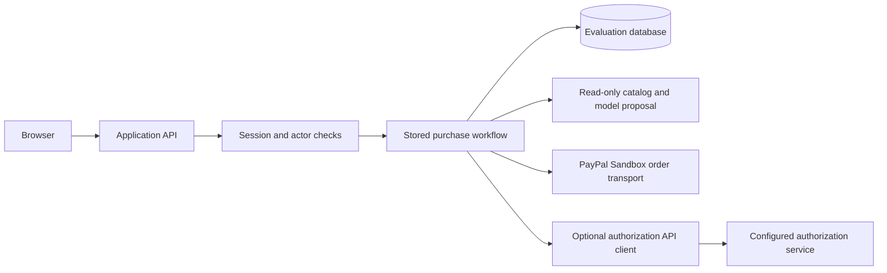

# Developer and AI handoff

Read [the repository instructions](../AGENTS.md), [architecture](architecture.md),
[verification status](verification-status.md) and [release policy](release-policy.md)
before changing code. [AI_CONTEXT.json](../AI_CONTEXT.json) is the machine-readable
index. This guide describes this repository only.

## Ownership and independent setup

This application owns its interface, API handlers, evaluation accounts, database
schema, catalog agent and PayPal Sandbox integration. The bundled authorization
client is installed from `vendor/agent-sdk`. All build and test inputs must be
available in this checkout or obtained from the documented public package registry.
No adjacent checkout, shared filesystem, developer account or external policy
service is required for fixture regression or the order/refusal demonstration.

Follow [judge setup](judge-setup.md) from a fresh source download. Use Node 24 and
PostgreSQL 17. Provision your own disposable database and evaluation account. Real
model/order checks additionally need your own provider credentials. Localhost
examples document how a reader runs their own copy; they are not maintainer
workstation locations or deployed service addresses.

## Request flow



The model returns an untrusted proposal. The server validates catalog membership,
quantity, decimal amount and budget before persisting a draft. Human review
applies to the stored purchase. Order preparation binds amount, currency, merchant,
purchase version and provider identity. Optional external authorization remains
a separate configured API boundary whose absence blocks canonical protected
capture. The isolated browser Sandbox path uses purchase-specific software
approval plus separately verified PayPal consent; it does not claim canonical
external authority.

## Change owners

| Change | Inspect first | Required evidence |
| --- | --- | --- |
| Pages and navigation | `src/app/`, `src/components/`, `src/shared/navigation.mjs` | Browser flow, authentication redirects, mobile layout and accessibility |
| Sessions and isolation | `src/server/auth.mjs`, API handlers | Anonymous, foreign-user/tenant and wrong-origin refusals |
| Proposals | `src/server/ai/` | Invalid model output, catalog/budget validation and durable quota refusal |
| Orders and execution | `src/server/paypal/`, `src/server/workflow.mjs` | Exact terms, stable request identity, replay/concurrency refusal and uncertain-outcome recovery |
| External authority client | `src/server/authorization/`, `vendor/agent-sdk/` | Exact envelope/signature/expiry binding; unavailable service cannot grant authority |
| Schema | `migrations/` | Migration on a disposable database and the affected persistence/restart tests |
| Packaging and documentation | `scripts/public-boundary.mjs`, this guide | Source audit, rejection tests, links and a clean committed-source export |

## Enterprise engineering controls

- Treat tenant and user checks as mandatory at every data boundary. A UI hidden
  control is not authorization.
- Keep deterministic policy, cryptographic verification and provider transport
  separate. A model, feature flag or provider success response cannot grant
  permission.
- Preserve decimal strings and exact signed protocol fields. Existing `Verid*`
  SDK symbols are compatibility identifiers, not a dependency on another checkout.
- Persist the execution identity before dispatch. An unknown outcome requires
  read-only reconciliation of that attempt, never a fresh payment request.
- Keep keys, database credentials and access tokens server-side. Never put them
  in browser-prefixed configuration, source, screenshots or public issues.
- Distinguish purchase review, signed authority, buyer consent, capture and a
  verified receipt in both API responses and UI copy.
- Record source revision, test target, failures, skips and acceptance limits.
  Passing fixtures or a build does not establish a working hosted payment flow.
- Lint covers JavaScript, TypeScript and TSX source. CI runs the complete checks
  both from the repository checkout and an exact committed source download, each
  with its own disposable PostgreSQL service. Third-party CI actions are pinned
  to immutable revisions.

These are engineering requirements, not a claim of certification, audited
enterprise readiness or production payment acceptance.

## Experience design

Keep the purchase journey simple: explain the need, review exact terms, show the
next permitted action and display the observed result. Keep protocol details in
developer documentation and optional evidence views. Never hide material consent,
amounts, merchant identity, a missing prerequisite or an uncertain outcome.

Derive readiness from backend facts. A signed approval is not provider completion;
a stored connection setting is not observed provider access. For a blocker, name
one safe next step and the responsible role. Planned capabilities must stay
visibly planned. The restricted evaluation's approval ceremony is not a claim
that every future enterprise workflow must require a separate human decision.

## Validation sequence

```sh
npm ci
npm run check:public
npm run test:boundary
npm run test:sdk
npm run lint
node scripts/migrate.mjs
npm test
npm run build
npm run typecheck
```

Set `DATABASE_URL` to a separately migrated disposable test database before the
migration and integration suite. Never use a retained demo or customer database.
Fixture regression needs no live model keys. Follow [release policy](release-policy.md)
for archive checks and distinguish regression from actual provider acceptance.

## Handling a failed live check

Stop dependent payment steps at the first broken boundary. Record the failing
route pattern and expected/actual status without account IDs or tokens. Preserve
generic public errors; collect only bounded internal error categories in the
operator's restricted channel. Reproduce the fault before changing enforcement.
Update [verification status](verification-status.md) when new evidence supersedes
an earlier result. Never convert a failed check into a successful fixture claim.
